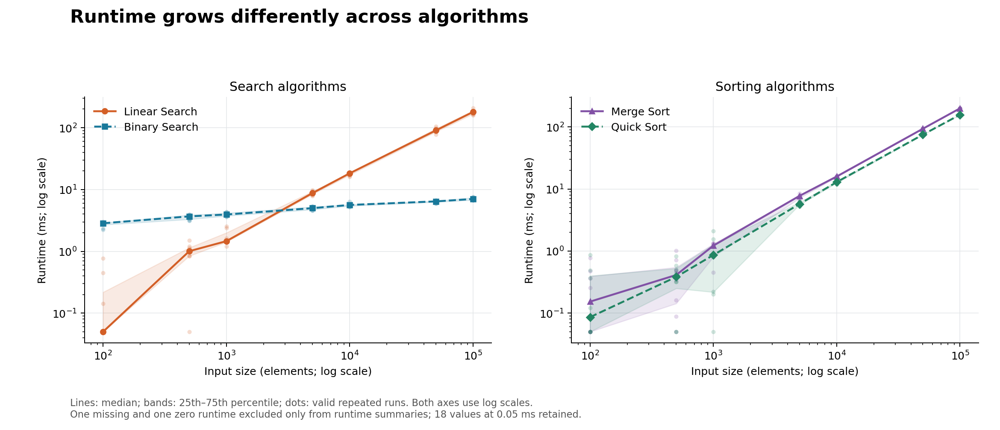
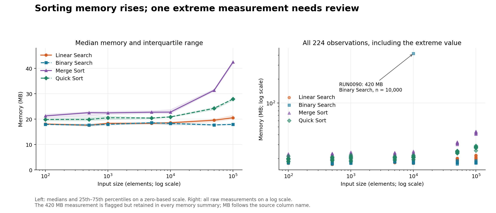
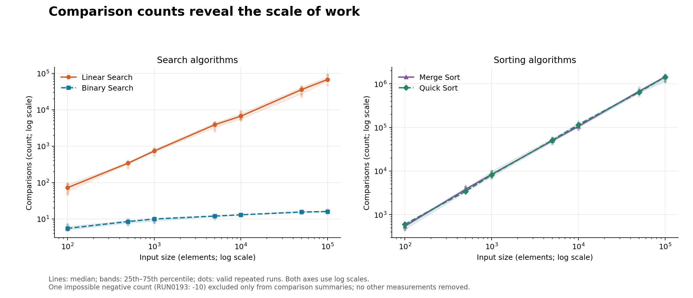

# 演算法測量資料：重要趨勢與視覺化

## 主要發現

1. **搜尋耗時出現規模交叉。** n=1,000 時 Linear Search 中位耗時為 1.4620 ms，低於 Binary Search 的 3.9405 ms；n=5,000 時分別為 8.7685 與 4.9975 ms。交叉只可定位在已測的 1,000–5,000 區間，無法推定精確臨界點。
2. **大型輸入時 Binary Search 耗時增長較緩。** n 從 100 增至 100,000（1,000 倍），其中位耗時從 2.8450 增至 7.0290 ms（2.47 倍）。n=100,000 時 Linear Search 為 179.6865 ms，Binary Search 耗時約為其 1/25.56。這是本資料的觀察，不代表所有環境皆如此。
3. **Quick Sort 在最大規模兼具較低耗時與記憶體中位數。** n=100,000 時 Quick Sort 為 157.4740 ms，Merge Sort 為 199.5465 ms；前者耗時低 21.1%。記憶體分別為 27.915 與 42.490 MB，前者低 34.3%。n=100–1,000 的計時較小且有集中在 0.05 ms 的值，不對微小差異做強排名。
4. **比較次數支持不同增長型態。** Binary Search 的比較次數中位數從 n=100 的 5.5 增至 n=100,000 的 16.0；Linear Search 從 72.0 增至 67,616.0。排序的比較次數大致隨 n log₂ n 增長，但有限測量不能證明漸近複雜度。
5. **420 MB 的極端值會扭曲平均數。** Binary Search、n=10,000 的記憶體中位數為 18.280 MB，平均數卻達 68.381 MB。僅作敏感度比較，若排除該旗標值，平均數為 18.150 MB（其餘 7 筆）；主要分析仍保留它。

## 資料品質與處理

- 原始資料 224 列、7 欄；4 種演算法 × 7 個輸入大小 × 8 次重複，28 個完整實驗組。沒有日期欄，因此這裡的趨勢指輸入規模變化，不能當作時間趨勢。
- 欄位：run_id、algorithm（字串）；input_size、repeat、comparisons（整數）；runtime_ms、memory_mb（浮點數）。數值轉換失敗均為 0。輸入大小為 [100, 500, 1000, 5000, 10000, 50000, 100000]，repeat 為 1–8。
- 缺失：僅 runtime_ms 1 筆，其他欄位均為 0。完全重複列、run_id 重複、algorithm/input_size/repeat 鍵重複皆為 0；重複測量是合法的實驗重複，沒有去重。
- 原始數值範圍：input_size 100–100,000；repeat 1–8；runtime_ms 0–207；memory_mb 16.92–420；comparisons -10–1,590,525。所有非缺失數值皆可轉換；無不合法的 input_size、repeat 或記憶體非正值。
- 18 筆 runtime_ms 恰為 0.05，集中在 n≤1,000。這可能是計時解析度或下限效果，來源未說明；全部保留，避免擅自修改。
- 不填補缺失、不修改 data.csv。每個指標獨立排除不可用值，處理後保留全部 224 列。有效耗時 222 筆、記憶體 224 筆、比較次數 223 筆；Linear Search/n=1,000 與 Merge Sort/n=5,000 的有效耗時各 7 筆，Quick Sort/n=5,000 的有效比較次數 7 筆，其餘每組各 8 筆。

| run_id | algorithm | input_size | 問題 | 處理 |
|---|---|---:|---|---|
| RUN0024 | Linear_Search | 1,000 | runtime_ms 缺失 | 耗時排除 1 筆；其他指標保留 |
| RUN0142 | Merge_Sort | 5,000 | runtime_ms = 0 | 視為無法判讀的計時值，耗時排除 1 筆；其他指標保留 |
| RUN0193 | Quick_Sort | 5,000 | comparisons = -10 | 比較次數排除 1 筆；其他指標保留 |
| RUN0090 | Binary_Search | 10,000 | memory_mb = 420 | 標記為極端值，保留於所有記憶體分析 |

記憶體極端值旗標定義：同一 algorithm/input_size 群組內，高於「中位數 + 10 × MAD（絕對離差中位數）」；本資料僅 RUN0090 觸發。旗標是待查線索，無法證明錯誤。

零耗時敏感度：Merge Sort/n=5,000 排除 0 的中位耗時為 7.7550 ms；若保留 0 則為 7.5245 ms，差異 3.06%，不改變與 Quick Sort 的觀察方向。

## 視覺化選擇與讀法

使用現有的 pandas、NumPy 與 Matplotlib。這是供閱讀及分享的固定比較分析，靜態 PNG 便於離線開啟；不需新增依賴。圖表標籤使用英文 DejaVu Sans，避免缺少中文字型；本報告以繁體中文說明。

- 耗時與比較次數採搜尋／排序分面折線圖：橫軸是有序的輸入規模，雙對數刻度容納多數量級；線與標記為每組中位數、色帶是第 25–75 百分位數、淡色點保留個別測量。不同類別搭配一致顏色、標記及線型。色帶表示觀測離散程度，**不是信賴區間**。
- 記憶體左圖採從 0 起的線性縱軸比較中位數與四分位區間；右圖使用對數縱軸顯示全部原始值，包含 420 MB，沒有隱藏極端值。各圖橫軸均為對數刻度；MB 是依原欄位名稱，無法確認是 MB 或 MiB。
- 不將不同任務的搜尋與排序排成同一效能名次；未計算跨演算法混合相關係數，避免共同輸入規模與任務差異造成誤導。

## 最大輸入規模的中位數（n=100,000）

| 演算法 | 耗時 (ms) | 記憶體 (MB) | 比較次數 |
|---|---:|---:|---:|
| Binary Search | 7.0290 | 17.925 | 16.0 |
| Linear Search | 179.6865 | 20.540 | 67,616.0 |
| Merge Sort | 199.5465 | 42.490 | 1,440,949.0 |
| Quick Sort | 157.4740 | 27.915 | 1,441,958.5 |

搜尋與排序解決的任務不同，表格只供各任務內比較。

## 限制

每組僅 8 次測量，且部分指標只剩 7 筆，沒有母體信賴區間或顯著性推論。未提供硬體、語言實作、輸入分布、暖機、計時方式、資料排序狀態與 Binary Search 前置排序成本，也不能確認相同 repeat 是否為配對輸入；因此不做配對檢定、因果推論或泛化效能保證。420 MB 與 0.05 ms 的成因需向資料來源確認；0 ms 被視為無法判讀的計時值是一項明示的分析假設。未擅自刪除其他離群值。

## 執行及驗證

在專案目錄執行 `MPLCONFIGDIR=/tmp/q3_with_agents_mpl XDG_CACHE_HOME=/tmp/q3_with_agents_cache python src/analyze.py`。每次重跑輸出新版本，保留既有成果。

程式檢查原檔 SHA-256 不變、28 個分組的計數與原始有效資料一致、摘要中位數與逐組重算結果一致，並使用 Pillow 解碼驗證所有 PNG。實際驗證結果另存 `validation_v1.json`；圖片另經人工視覺檢查。

原始檔 SHA-256：`8285b2903f318ef452e7706b627a9f4bf6bc21cd6e72ba858c14c57d92a2136a`。
環境：Python 3.12.14；pandas 2.2.3；NumPy 2.3.5；Matplotlib 3.10.8。
