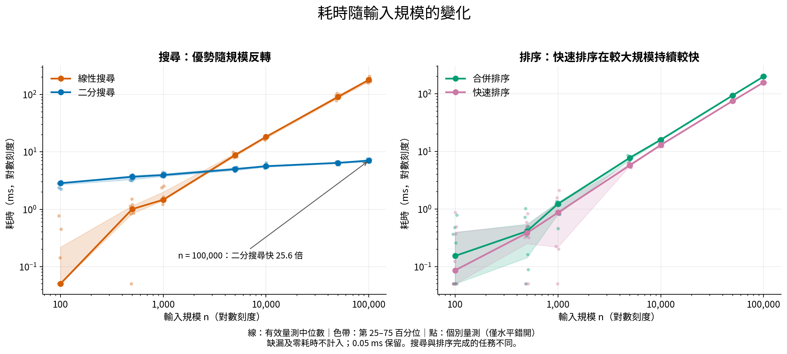
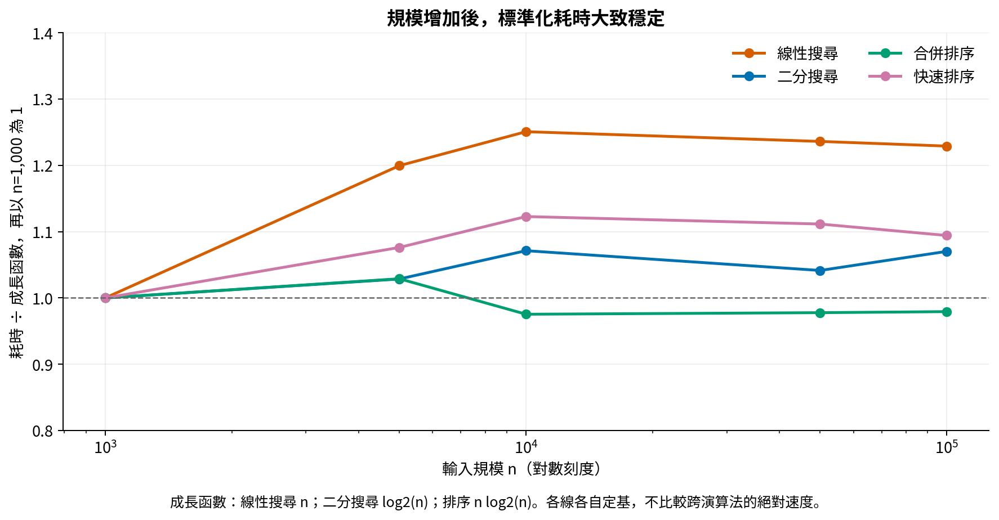
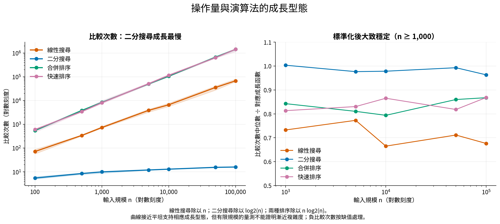
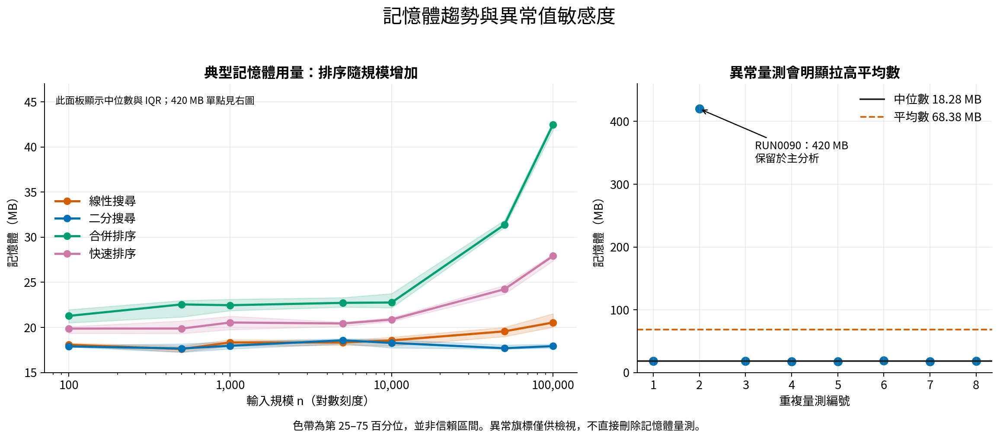

# 演算法效能資料分析

## 主要發現

1. **搜尋效能出現規模轉折。** 在已測的 n=100、500、1,000，線性搜尋的中位耗時較低；從 n=5,000 起，二分搜尋較快。n=100,000 時，線性搜尋為 179.6865 ms，二分搜尋為 7.0290 ms，後者快 **25.56 倍**。只能確定已測點的優勢在 1,000 與 5,000 之間反轉，沒有量到精確交叉點。
2. **較大輸入下，快速排序兼具較低耗時與記憶體。** n≥1,000 的各組中位耗時均低於合併排序；n=100,000 時為 157.4740 vs. 199.5465 ms，快速排序耗時低 **21.1%**。記憶體中位數為 27.915 vs. 42.490 MB，低 **34.3%**。
3. **操作次數呈現不同成長型態。** n=100,000 時，二分搜尋比較次數中位數僅 16，線性搜尋為 67,616，兩種排序約 144 萬。n≥1,000 時，將比較次數分別除以 log2(n)、n 或 n log2(n) 後大致穩定，支持相應的成長趨勢。不同任務的操作數不能直接作為演算法優劣排名。
4. **記憶體的一次尖峰會誤導平均數。** 二分搜尋 n=10,000 的 RUN0090 為 420 MB，其餘七次介於 17.56–19.03 MB。該組平均數為 68.38 MB，中位數僅 18.28 MB；尖峰保留在分析中並獨立呈現。

## 資料與處理原則

- 原始資料 **224 筆、7 欄**；4 種演算法 × 7 種輸入規模（100 至 100,000）× 每組 8 次。沒有重複 run_id 或重複的演算法／規模／重複編號組合。
- 這是**輸入規模趨勢**，資料沒有時間欄位；run_id 與 repeat 不當成時間序列。
- RUN0024 缺少 runtime_ms；RUN0142 runtime_ms=0 視為無效耗時；RUN0193 comparisons=-10 視為無效比較次數。只排除該欄位，不刪整列，也不補值。因此有效耗時 **222 筆**、記憶體 **224 筆**、比較次數 **223 筆**。
- 記憶體使用各演算法／規模組內 1.5 IQR 規則標記潛在離群值，**不刪除**；完整清單見 quality_issues.csv。旗標不代表量測必然錯誤，也不以此推論成因。
- 有 **18 筆耗時等於 0.05 ms**（17 筆在 n≤500，另 1 筆在 n=1,000）。可能與量測解析度、下限截斷或資料生成方式有關，資料不足以判定。保留這些值，但不把小規模的細微排序視為穩健結論。
- 分組以**中位數與第 25–75 百分位（IQR）**為主；色帶表示量測分散程度，**不是信賴區間**。缺值排除後有 7 筆的組別會按 7 筆計算；其餘為 8 筆。

## 耗時趨勢

各規模的耗時中位數（ms；按有效量測計算）：

| 輸入規模 | 線性搜尋 | 二分搜尋 | 合併排序 | 快速排序 |
|---:|---:|---:|---:|---:|
| 100 | 0.0500 | 2.8450 | 0.1530 | 0.0860 |
| 500 | 1.0050 | 3.6785 | 0.4115 | 0.3830 |
| 1,000 | 1.4620 | 3.9405 | 1.2225 | 0.8635 |
| 5,000 | 8.7685 | 4.9975 | 7.7550 | 5.7290 |
| 10,000 | 18.2865 | 5.6285 | 15.8995 | 12.9270 |
| 50,000 | 90.3585 | 6.4280 | 93.6150 | 75.1650 |
| 100,000 | 179.6865 | 7.0290 | 199.5465 | 157.4740 |

輸入從 1,000 增加至 100,000（100 倍）時：

| 演算法 | n=1,000 耗時（ms） | n=100,000 耗時（ms） | 耗時成長 |
|---|---:|---:|---:|
| 線性搜尋 | 1.4620 | 179.6865 | 122.90 倍 |
| 二分搜尋 | 3.9405 | 7.0290 | 1.78 倍 |
| 合併排序 | 1.2225 | 199.5465 | 163.23 倍 |
| 快速排序 | 0.8635 | 157.4740 | 182.37 倍 |

標準化耗時在較大規模下大致平穩。這是有限量測範圍的描述，不是對程式實作或理論複雜度的證明；線性搜尋 n=1,000 的基準組也有一筆缺失，需一併考量。

## 比較次數

二分搜尋在輸入增加時的比較次數增長很小，解釋了它在大型輸入的速度優勢。兩種排序在 n=100,000 的比較次數相近，但耗時仍有差異；僅憑這份資料無法把耗時差異歸因於比較次數、常數成本、記憶體存取或實作細節中的某一項。

## 記憶體

二分搜尋各規模的記憶體中位數介於 17.665–18.570 MB，線性搜尋在 n=100,000 時為 20.540 MB；排序的記憶體在大規模時增加較明顯。記憶體欄位未說明是峰值、平均值或額外配置量，故不將其解釋為理論輔助空間。

## 解讀限制與建議

- 搜尋與排序解決不同問題，應在同類演算法間比較。二分搜尋通常需要已排序輸入；資料未說明是否計入排序前處理，不能直接推導任意搜尋工作流程的總成本。
- 沒有硬體、語言、實作、資料分布、搜尋命中位置、計時方式、隨機種子或實驗順序資料。相同 repeat 編號不代表配對樣本；此分析不採用配對推論。
- 每組僅 8 次，未做統計顯著性或泛化性能宣稱。排序在小規模的差距尤其容易受量測下限和變動影響。
- 若目標是大量已排序資料的搜尋，優先評估二分搜尋；若目標是本實驗條件下的大規模排序，快速排序表現較好。正式採用前應補測 1,000–5,000 的搜尋轉折、調查 420 MB 尖峰，並改善小規模計時方式與增加重複次數。

## 重現與輸出

在此目錄執行：`python analyze.py`。僅需已安裝的 Python、pandas、NumPy 與 Matplotlib；不需下載套件或連網。程式自動將快取放到 /tmp，並使用可用的 Noto Sans CJK JP 字型。

- `analysis_report.html`：可離線開啟，圖像已嵌入。
- `analysis_report.md`：本報告；四張圖皆有 PNG 與 SVG。
- `summary.csv`：84 組「演算法 × 規模 × 指標」的有效筆數、中位數、IQR、平均數、標準差與極值。
- `analysis_data.csv`：逐欄處理後的分析資料；原始 data.csv 不變。
- `quality_issues.csv`、`runtime_floor_counts.csv`：資料品質與 0.05 ms 集中情況。
- `normalized_comparisons.csv`、`runtime_scaling.csv`：標準化趨勢數值。
- `validation.json`：版本、輸入 SHA-256、資料筆數、輸出與執行驗證結果。
